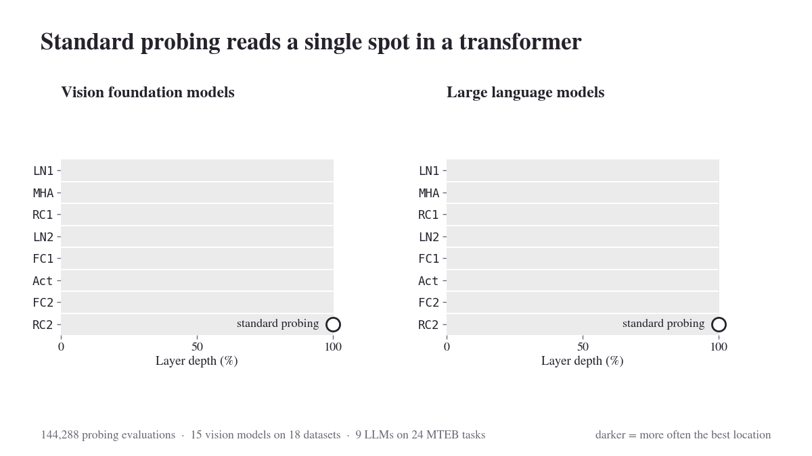

# Probing Transformer Representations Layer by Layer, Module by Module

[](https://arxiv.org/abs/2611.11531)
[](https://huggingface.co/papers/2611.11531)
[](https://ambroiseodt.github.io/waldo/)
[](https://github.com/ambroiseodt/waldo/actions)
[](https://www.python.org/downloads/)
[](LICENSE)

Official implementation of the paper **[Probing Transformer Representations Layer by Layer, Module by Module](https://arxiv.org/abs/2611.11531)** ([project page](https://ambroiseodt.github.io/waldo/)). <br>
**Goal**: Understand which transformer representations should be probed in foundation models. <br>
**Findings**: The gain over standard probing depends jointly on the layer and module choices; for VFMs, these gains grow under distribution shift. <br>
**Practical takeaways**: Simple fixed strategies without search recover much of the gains: the FFN activation of the last layer (Act@100) for VFMs, and the second normalization at 60% depth (LN2@60) for LLMs.

<p align="center">
  
</p>

## Abstract
Which representation should be probed in a transformer-based foundation model? Recent work shows that the standard practice of probing the final layer is often suboptimal, as intermediate layers can provide better features. Yet, representations are still largely studied along depth alone, treating each transformer block as an atomic unit. In this work, we analyze transformer representations *layer by layer, module by module*. Through more than 144,000 linear probing evaluations of vision foundation models (VFMs) and large language models (LLMs), we show that layer and module choices should be considered jointly: the best layer-module pair yields substantially larger gains over the final-layer residual stream than the best layer with the residual stream fixed. Moreover, module performance can vary substantially across layers, showing that useful representations cannot be characterized by depth alone. Building on these findings, we evaluate simple fixed probing strategies: the final-layer feedforward activation (Act@100) for vision and the second normalization layer at 60% depth (LN2@60) for language. These strategies improve over the probing baseline in a majority of evaluations and recover, on average, 42% and 86% of the gains from probing the best layer-module pair for vision and language, respectively. For VFMs, these gains increase with the transfer difficulty between pretraining and downstream data. 

<p align="center">
  
</p>

## Overview
Our codebase was tailored to study transformer representations across layers and modules in vision foundation models (ViT, DINOv2, DINOv3, AIMv2) and LLMs (Gemma3, Llama3, Qwen3); we tried to make the code as modular as possible, so feel free to branch out or fork and play with it. It is structured as follows:

```
🛠️ waldo
┣ 📂analysis # Aggregation of the runs, paper figures and tables
┃ ┣ 📂results # Results of the paper (csv)
┃ ┣ 📄aggregate.py
┃ ┗ 📄analysis.py
┣ 📂apps # Experiments
┃ ┣ 📂language # MTEB evaluation of LLMs
┃ ┃ ┣ 📂configs
┃ ┃ ┗ 📄eval.py
┃ ┣ 📂vision # Linear probing of vision models
┃ ┃ ┣ 📂configs
┃ ┃ ┣ 📄eval.py
┃ ┃ ┗ 📄eval_cifar10_c.py
┃ ┗ 📄setup.py
┣ 📂scripts # Launch scripts of the experiments of the paper
┣ 📂src
┃ ┗ 📂waldo # Core library
┃   ┣ 📂data # Vision datasets and MTEB benchmarks
┃   ┣ 📂eval # Linear probing
┃   ┣ 📂infra # Paths and configuration parsing
┃   ┗ 📂models # Models, block adapters, pooling
┗ 📂tests # Unit tests, mirroring src/waldo and apps
```
The `waldo` library contains the generic components (models and hooks, datasets, linear probing), which are put
together in `apps` to run the experiments of the paper.

## Getting started
The code runs Python 3.12+. We recommend installing it in a new environment, e.g. with
[miniforge](https://github.com/conda-forge/miniforge):
```bash
conda create -n waldo python=3.12
conda activate waldo
```
Install the repository with the dependencies of the experiments (cuML requires an NVIDIA GPU and the NVIDIA index):
```bash
git clone https://github.com/ambroiseodt/waldo.git
cd waldo
pip install -e ".[exps,figs]" --extra-index-url https://pypi.nvidia.com
```
The dependency groups are `exps` (experiments), `figs` (aggregation and figures), `test` (tests, no GPU needed) and
`dev` (linting). To run the tests on a machine without GPU, install the CPU build of PyTorch first to avoid
downloading ~4 GB of CUDA libraries:
```bash
pip install torch==2.9.1 torchvision==0.24.1 --index-url https://download.pytorch.org/whl/cpu
pip install -e ".[test,dev]"
```

#### HuggingFace models
DINOv3, Gemma3 and Llama3 models are gated: request access on their HuggingFace pages and log in with `hf auth login` (see
[gated models](https://huggingface.co/docs/hub/en/models-gated)). The weights of all the models of the paper can be
downloaded in advance with `bash scripts/models/download_models.sh`.

> [!NOTE]
> Dependencies are pinned in `pyproject.toml`. Libraries such as [transformers](https://github.com/huggingface/transformers)
> and [MTEB](https://github.com/embeddings-benchmark/mteb) change frequently, and other versions may change the behavior
> of the code.

## Using the library
Models are built from a configuration dictionary and return all the requested representations in a single forward
pass:
```python
import torch
from waldo.models import build_model

# Vision: pooled representations of given layers and modules, stored on CPU
model = build_model({"model_name": "dinov2", "model_size": "base", "device": "cuda:0"})
images = torch.randn(4, 3, 224, 224, device="cuda:0")  # preprocessed with waldo.data.build_transform
embeddings = model.get_embeddings(images, layers=[-1], modules=["act", "rc2"])
# {"block_11_act": tensor of shape (4, 3072), "block_11_rc2": tensor of shape (4, 768)}

# Language: sentence embeddings at the second normalization of 60% of the depth (LN2@60)
model = build_model({"model_name": "qwen3", "model_size": "0.6B", "device": "cuda:0"})
model.set_probing(layer=int(0.6 * (model.n_layers - 1)), module="ln2")
embeddings = model.encode(["A first sentence.", "A second one."], task_metadata=None, hf_split="", hf_subset="")
```
Language models implement the MTEB encoder interface and can be passed directly to `mteb.evaluate`.

#### Adding a model
A model is defined by a configuration dataclass, a block adapter mapping the standard module names to the submodules of
its transformer blocks, and a class loading the HuggingFace model (see `src/waldo/models/vision/vit.py`). It is then
registered in `build_model` (`src/waldo/models/factory.py`) and exported in the `__init__.py` of its package. Datasets
follow the same pattern with `build_dataset` (`src/waldo/data/vision/factory.py`).

## Launching jobs
We provide below the commands to run the experiments. They must be run from the root of the repository.

### Configuration
Each experiment is configured by a dataclass, e.g. for linear probing:
```python
@dataclass
class EvaluationConfig:
    model_name: str = "vit"
    model_size: str = "base"
    dataset_name: str = "cifar10"
    layers: list[int | str] = field(default_factory=lambda: ["all"])
    modules: list[str] = field(default_factory=lambda: ["all"])
    device: str = DEVICE
    ...
```
We use [OmegaConf](https://omegaconf.readthedocs.io/en/2.3_branch/usage.html#from-command-line-arguments):
1. The dataclass is instantiated with its default values,
2. Those default values are overridden with the ones in the YAML configuration file,
3. The result is overridden with the additional arguments provided through command line.

The main options are:
- `layers` and `modules` select the representations to probe, e.g. `layers=[-1] modules=[act]` for the FFN activation
  of the last layer. Both are set to `["all"]` in the provided configs.
- `model_size` selects the variant, e.g. `model_size=large` for DINOv2-L.
- `log_dir` is the directory of the runs relative to `savings/` (default `runs`), e.g. `log_dir=my_runs` to keep new
  runs separate from the results of the paper.

### Vision models
To probe every layer and module of DINOv2-B on Cifar10, run:
```bash
python -m apps.vision.eval config=apps/vision/configs/dinov2.yaml dataset_name=cifar10 device=cuda:0
```
To train the probes on Cifar10 and evaluate them on each corruption and severity of Cifar10-C, run:
```bash
python -m apps.vision.eval_cifar10_c config=apps/vision/configs/cifar10_c.yaml device=cuda:0
```
Most datasets are downloaded automatically in `datasets/` (torchvision and [WILDS](https://wilds.stanford.edu/)
datasets). Cifar10-C and DomainNet must be downloaded manually, following the docstrings of
`src/waldo/data/vision/cifar10_c.py` and `src/waldo/data/vision/domainnet.py`.

### Language models
To evaluate every layer and module of Qwen3-0.6B on the classification tasks of MTEB(Multilingual), run:
```bash
python -m apps.language.eval config=apps/language/configs/qwen3.yaml layers=[all] modules=[all] device=cuda:0
```

Runs are saved in `savings/<log_dir>/<dataset>/<model>/`, i.e. `savings/runs/<dataset>/<model>/` by default. Complete
evaluations are skipped when launched again, and interrupted ones are recomputed. Setting `overwrite=true` deletes the
existing results of a run and recomputes them.

## Reproducibility
The experiments of the paper can be reproduced using the scripts in `scripts/`, which create dedicated `tmux`
sessions for each group of experiments:
```bash
bash scripts/vision/eval.sh            # linear probing of the vision models
bash scripts/vision/eval_cifar10_c.sh  # Cifar10-C
bash scripts/language/eval.sh          # MTEB evaluation of the LLMs
```
The runs are then aggregated in `analysis/results/runs/` (one row per layer and module, with a per-model summary in
`summary/`) by running the following commands from the root of the repository (`cifar10_c` and `mteb` work the
same way):
```bash
python analysis/aggregate.py cls
python analysis/aggregate.py analysis_cls
```
The results of the paper are provided in `analysis/results/runs/` (csv files tracked with Git LFS, run `git lfs pull`
after cloning). The figures and tables of the paper can be reproduced from them:
```bash
python analysis/analysis.py plot   # figures, saved in figures/
python analysis/analysis.py table  # LaTeX tables
```

## Tests
The tests run on CPU without network access, using tiny randomly initialized models with the architecture of the
pretrained ones:
```bash
pytest                                  # all tests, with coverage
pytest tests/src/waldo/models/vision    # one folder
ruff check . && ruff format --check .   # linting and formatting
```

## Acknowledgements
Our codebase draws inspiration from libraries like [vit-plasticity](https://github.com/ambroiseodt/vit-plasticity),
[vit-probing](https://github.com/ambroiseodt/vit-probing) and [lingua](https://github.com/facebookresearch/lingua).

## Contact
If you have any questions, feel free to reach out at
[```ambroiseodonnattechnologie@gmail.com```](mailto:ambroiseodonnattechnologie@gmail.com).

## Citation
If you find our work useful, please consider giving a star ⭐, and citing us as:
```
@misc{odonnat2026probing,
      title={Probing Transformer Representations Layer by Layer, Module by Module}, 
      author={Ambroise Odonnat and Theo Gnassounou and Laetitia Chapel and Romain Tavenard and Ievgen Redko},
      year={2026},
      eprint={2611.11531},
      archivePrefix={arXiv},
      primaryClass={cs.LG},
      url={https://arxiv.org/abs/2611.11531}, 
}
```